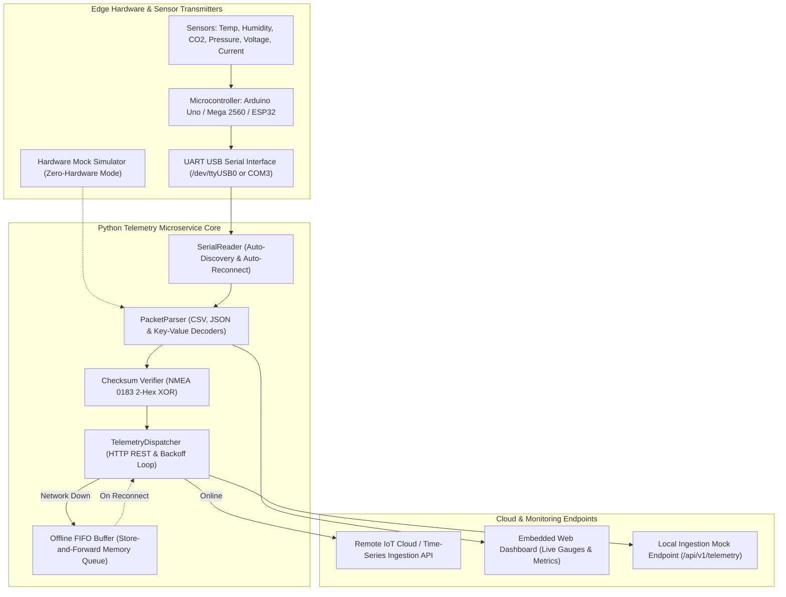
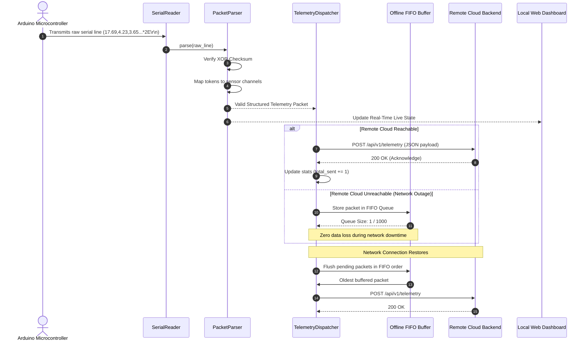

# Arduino Serial Sensor Telemetry Microservice IoT

[](https://github.com/KevinAndrey96/python-arduino-serial-sensor-telemetry-microservice/actions/workflows/ci.yml)
[](https://www.python.org/)
[](https://www.arduino.cc/)
[](https://www.docker.com/)
[](LICENSE)

Production-grade edge-to-cloud IoT serial telemetry gateway and microservice engineered in Python. Connects physical microcontroller sensor nodes (**Arduino Uno, Nano, Mega 2560, ESP32, STM32**) via USB Serial UART to remote cloud backends, time-series databases, and REST APIs.

Designed to address mission-critical embedded IoT challenges: automatic USB serial port discovery, dynamic reconnection upon cable disconnects, checksum frame validation, multi-sensor parsing, resilient offline FIFO store-and-forward buffering during cloud network outages, and a built-in hardware mock simulator for development without physical boards.

---

## 🧭 Problem Statement & Embedded IoT Architecture

In industrial and environmental automation (such as incubators, green houses, weather stations, and battery management systems), microcontrollers continuously sample analog and digital sensors. Transmitting these high-frequency streams directly to remote HTTP endpoints presents key field issues:
1. **Serial Line Noise & Corrupted Frames**: Physical UART lines can experience baud jitter or framing errors.
2. **Transient Network Dropouts**: Edge internet drops (WiFi/cellular) can cause immediate data loss without local queuing.
3. **USB Port Disconnects**: Vibration or power cycles cause virtual COM ports (`/dev/ttyUSB0`) to reset.

This microservice provides an asynchronous pipeline that synchronizes frames, verifies XOR checksums, parses multi-channel sensor arrays, buffers telemetry locally during network faults, and flushes chronologically once internet connectivity is restored.

---

## 🏗️ System Architecture



---

## 🔄 Telemetry Transmission & Resilience Sequence



---

## 📡 Sensor Channel Telemetry Specifications

The default parser unpacks standard 7-channel CSV sensor telemetry bursts:
`17.69,4.23,3.65,1.96,2.54,15.69,1.23`

| Channel | Sensor Metric | Typical Physical Sensor | Engineering Units | Operational Range |
| :---: | :--- | :--- | :---: | :---: |
| **Ch 0** | `temp_ambient_c` | DS18B20 / LM35 / NTC | °C | -40.0 to 85.0 |
| **Ch 1** | `temp_chamber_c` | DS18B20 (Immersion/Probe) | °C | -20.0 to 125.0 |
| **Ch 2** | `humidity_pct` | DHT22 / AM2302 / SHT31 | % RH | 0.0 to 100.0 |
| **Ch 3** | `co2_ppm` | MH-Z19 NDIR / MQ-135 | ppm | 350.0 to 5000.0 |
| **Ch 4** | `pressure_kpa` | BMP280 / BME680 / MPX5010 | kPa | 80.0 to 115.0 |
| **Ch 5** | `voltage_v` | Precision Voltage Divider | Volts (V) | 0.0 to 25.0 |
| **Ch 6** | `current_a` | Hall-Effect Sensor ACS712 | Amperes (A) | 0.0 to 20.0 |

---

## ⚡ Arduino Hardware Reference Firmware

The repository includes a ready-to-flash C++ sketch located at [`firmware/arduino_telemetry_transmitter.ino`](firmware/arduino_telemetry_transmitter.ino).

```cpp
// Serial Telemetry Transmitter Sketch (Arduino Uno / Nano / Mega)
#define BAUD_RATE 9600
#define TRANSMIT_INTERVAL_MS 1000

void loop() {
  // Read analog & digital sensors
  float tempAmbient = (analogRead(A0) * 500.0) / 1024.0;
  float tempChamber = (analogRead(A1) * 500.0) / 1024.0;
  float humidity    = (analogRead(A2) * 100.0) / 1024.0;
  float co2         = (analogRead(A3) * 2000.0) / 1024.0;
  float pressure    = (analogRead(A4) * 150.0) / 1024.0;
  float busVoltage  = (analogRead(A5) * 25.0) / 1024.0;
  float loadCurrent = ((analogRead(A6) * (5.0 / 1024.0)) - 2.5) / 0.185;

  // Format and transmit frame with checksum
  String payload = String(tempAmbient, 2) + "," + String(tempChamber, 2) + "," +
                   String(humidity, 2) + "," + String(co2, 2) + "," +
                   String(pressure, 2) + "," + String(busVoltage, 2) + "," +
                   String(loadCurrent, 2);

  Serial.println(payload);
  delay(TRANSMIT_INTERVAL_MS);
}
```

---

## 🚀 Quick Start

### 1. Zero-Hardware Simulation Mode (Runs out of the box)
Clone the repository and run in hardware simulator mode without needing an Arduino connected:

```bash
git clone https://github.com/KevinAndrey96/python-arduino-serial-sensor-telemetry-microservice.git
cd python-arduino-serial-sensor-telemetry-microservice

python3 main.py --simulate --web
```

Open your browser at:
- **Monitoring Web Dashboard**: [http://localhost:8080](http://localhost:8080)
- **Healthcheck**: `http://localhost:8080/api/v1/health`
- **Latest Telemetry JSON**: `http://localhost:8080/api/v1/telemetry/latest`
- **Dispatcher Metrics**: `http://localhost:8080/api/v1/metrics`

### 2. Physical Arduino Hardware Mode
Connect your Arduino board via USB and run:

```bash
# Auto-detects port or specify --port /dev/ttyUSB0
python3 main.py --port auto --baud 9600 --endpoint "https://your-cloud.com/api/v1/telemetry"
```

### 3. Docker Compose Orchestration
```bash
docker compose up -d --build
```
Access dashboard at [http://localhost:8085](http://localhost:8085).

---

## 📡 REST API & Monitoring Endpoints

### 1. Healthcheck
```bash
curl -X GET http://localhost:8080/api/v1/health
```
```json
{
  "status": "UP",
  "service": "python-arduino-serial-sensor-telemetry-microservice",
  "uptime_sec": 42.5
}
```

### 2. Query Latest Sensor Reading
```bash
curl -X GET http://localhost:8080/api/v1/telemetry/latest
```
```json
{
  "status": "success",
  "latest_telemetry": {
    "sequence_id": 14,
    "timestamp": "2026-11-24T20:15:30.123456+00:00",
    "format": "csv",
    "channel_count": 7,
    "sensors": {
      "temp_ambient_c": 22.84,
      "temp_chamber_c": 37.49,
      "humidity_pct": 59.82,
      "co2_ppm": 451.2,
      "pressure_kpa": 101.32,
      "voltage_v": 12.01,
      "current_a": 1.26
    },
    "status": "VALID"
  }
}
```

### 3. Dispatcher Performance & Store-and-Forward Metrics
```bash
curl -X GET http://localhost:8080/api/v1/metrics
```
```json
{
  "status": "success",
  "metrics": {
    "total_sent": 120,
    "total_failed": 0,
    "total_buffered": 0,
    "total_flushed_from_buffer": 0,
    "buffer_size": 0,
    "is_connected": true,
    "mode": "simulation"
  },
  "uptime_sec": 120.0
}
```

---

## 🧪 Automated Testing Suite

The repository includes a comprehensive zero-dependency verification script as well as pytest unit tests:

```bash
# Standalone zero-dependency test runner
python3 scripts/run_verification.py

# Or via pytest
pytest -v
```

Expected output:
```text
[*] Starting Arduino Serial Telemetry Gateway Test Suite...

[1/4] Testing Packet Parser (CSV, JSON, Key-Value)...
  -> Passed: Multi-format parsing and checksum verification working.

[2/4] Testing Sensor Simulator...
  -> Passed: Mock sensor streams generated with valid ranges.

[3/4] Testing Resilient Dispatcher Offline Queuing...
  -> Passed: Offline store-and-forward queueing verified.

[4/4] Testing Monitoring Server & Ingestion Receiver...
  -> Passed: Monitoring API and telemetry receiver verified.

============================================================
[SUCCESS] All 4 Telemetry Microservice test modules passed!
============================================================
```

---

## 📁 Repository Structure

```text
├── firmware/
│   └── arduino_telemetry_transmitter.ino  # Ready-to-flash Arduino C++ firmware sketch
├── scripts/
│   └── run_verification.py                # Standalone test runner (zero external dependencies)
├── src/
│   ├── __init__.py                        # Package exports
│   ├── config.py                          # Environment settings
│   ├── dispatcher.py                      # Resilient HTTP client with offline FIFO queue
│   ├── gateway.py                         # Telemetry orchestrator
│   ├── packet_parser.py                   # CSV / JSON / Key-Value parser with checksum
│   ├── serial_reader.py                   # PySerial manager with auto-discovery & reconnect
│   ├── server.py                          # Built-in monitoring server & web dashboard
│   └── simulator.py                       # Hardware mock sensor stream generator
├── tests/
│   ├── test_api.py                        # Server and receiver endpoint tests
│   ├── test_dispatcher.py                 # Offline buffering and store-and-forward tests
│   ├── test_packet_parser.py              # Parsing and checksum tests
│   └── test_simulator.py                  # Simulation generation tests
├── docker-compose.yml                     # Multi-container orchestration (port :8085)
├── Dockerfile                             # Lightweight Python container
├── main.py                                # CLI entrypoint
├── requirements.txt                       # Python dependencies
└── README.md
```

---

## 📄 License

This project is licensed under the [MIT License](LICENSE).
Open-source microservice for embedded IoT sensor telemetry and edge computing.
